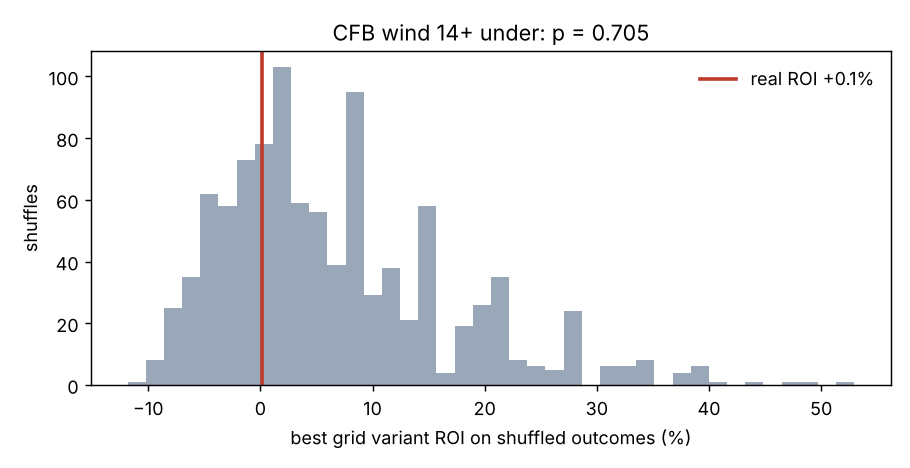

# CFB wind 14+ under (cfb_wind14)

Verdict: **RETIRE** (grid p 0.705; walk-forward -4.2% on 128 (p 0.390); holdout +92.7% on 4; no plateau)

Live definition: t 14. Price: Pinnacle full-game close. Seasons: 2020, 2021, 2022, 2023, 2024, 2025; holdout 2025. Base pool: 3871 bets of this market.

## Gate 1: in-sample (all seasons before the holdout)

N 186, record 96-88, units +0.22, ROI +0.1%. Flags: none. Leakage review: none.

| Season | N | ROI |
|---|---|---|
| 2020 | 26 | +4.5% |
| 2021 | 44 | +17.9% |
| 2022 | 49 | +5.3% |
| 2023 | 29 | -10.9% |
| 2024 | 38 | -21.7% |
| 2025 | 22 | +13.1% |

## Gate 2: permutation (1,000 shuffles within season x price decile)

Best of 9 grid variants per shuffle (N >= 30): p = 0.705. Plain single-filter permutation (weaker): p = 0.306.

## Gate 3: walk-forward (fit on earlier seasons, bet the next blind)

| Season | Variant fitted | N | ROI |
|---|---|---|---|
| 2022 | t 13 | 70 | +3.9% |
| 2023 | t 15 | 16 | -22.2% |
| 2024 | t 14 | 38 | -21.7% |
| 2025 (holdout) | t 18 | 4 | +92.7% |

Out-of-sample before the holdout: -7.3% on 124. Holdout: +92.7% on 4. All walk-forward seasons: -4.2% on 128.

## Gate 4: walk-forward permutation (200 shuffles of the walk-forward seasons)

p = 0.390 (bar 0.01 with 4 walk-forward season(s)).

## Plateau (grid neighbours of the live definition, in-sample)

| Variant | N | ROI |
|---|---|---|
| t 13 | 256 | -1.7% |
| t 15 | 120 | -2.6% |

Plateau: no.

## Whole grid (in-sample)

| Variant | N | ROI |
|---|---|---|
| t 18 | 30 | +1.8% |
| t 14 | 186 | +0.1% |
| t 10 | 672 | -0.1% |
| t 12 | 374 | -0.4% |
| t 13 | 256 | -1.7% |
| t 11 | 489 | -1.8% |
| t 15 | 120 | -2.6% |
| t 16 | 89 | -7.5% |
| t 17 | 48 | -16.5% |
