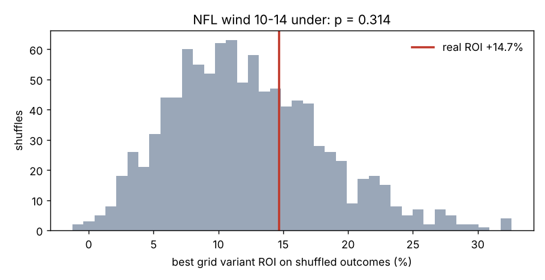

# NFL wind 10-14 under (wind1014)

Verdict: **PAPER ONLY** (grid p 0.314; walk-forward +28.3% on 104 (p 0.000); holdout +57.0% on 22)

Live definition: lo 10, hi 14. Price: Pinnacle full-game close. Seasons: 2020, 2021, 2022, 2023, 2024, 2025; holdout 2025. Base pool: 969 bets of this market.

## Gate 1: in-sample (all seasons before the holdout)

N 211, record 124-86, units +30.98, ROI +14.7%. Flags: none. Leakage review: none: kickoff-hour wind is a forecast quantity; the archive is observed (see limits).

| Season | N | ROI |
|---|---|---|
| 2020 | 32 | +4.3% |
| 2021 | 47 | +15.7% |
| 2022 | 44 | +32.2% |
| 2023 | 48 | +27.3% |
| 2024 | 40 | -12.6% |
| 2025 | 28 | +41.0% |

## Gate 2: permutation (1,000 shuffles within season x price decile)

Best of 29 grid variants per shuffle (N >= 30): p = 0.314. Plain single-filter permutation (weaker): p = 0.056.

## Gate 3: walk-forward (fit on earlier seasons, bet the next blind)

| Season | Variant fitted | N | ROI |
|---|---|---|---|
| 2022 | lo 11, hi 14 | 34 | +36.8% |
| 2023 | lo 11, hi 14 | 24 | +21.5% |
| 2024 | lo 11, hi 14 | 24 | -3.3% |
| 2025 (holdout) | lo 11, hi 14 | 22 | +57.0% |

Out-of-sample before the holdout: +20.6% on 82. Holdout: +57.0% on 22. All walk-forward seasons: +28.3% on 104.

## Gate 4: walk-forward permutation (200 shuffles of the walk-forward seasons)

p = 0.000 (bar 0.01 with 4 walk-forward season(s)).

## Plateau (grid neighbours of the live definition, in-sample)

| Variant | N | ROI |
|---|---|---|
| lo 9, hi 14 | 272 | +11.6% |
| lo 11, hi 14 | 137 | +17.7% |
| lo 10, hi 13 | 189 | +10.5% |
| lo 10, hi 15 | 230 | +12.7% |

Plateau: yes.

## Whole grid (in-sample)

| Variant | N | ROI |
|---|---|---|
| lo 11, hi 14 | 137 | +17.7% |
| lo 12, hi 14 | 90 | +16.4% |
| lo 11, hi 99 | 228 | +15.4% |
| lo 11, hi 16 | 179 | +14.9% |
| lo 10, hi 14 | 211 | +14.7% |
| lo 11, hi 15 | 156 | +14.4% |
| lo 12, hi 99 | 181 | +14.2% |
| lo 10, hi 99 | 302 | +13.9% |
| lo 10, hi 16 | 253 | +13.3% |
| lo 12, hi 16 | 132 | +13.1% |
| lo 10, hi 15 | 230 | +12.7% |
| lo 12, hi 15 | 109 | +12.0% |
| lo 9, hi 99 | 363 | +11.7% |
| lo 9, hi 14 | 272 | +11.6% |
| lo 11, hi 13 | 115 | +11.3% |
| lo 9, hi 16 | 314 | +10.9% |
| lo 10, hi 13 | 189 | +10.5% |
| lo 8, hi 99 | 436 | +10.4% |
| lo 9, hi 15 | 291 | +10.3% |
| lo 8, hi 14 | 345 | +10.0% |
| lo 11, hi 12 | 94 | +9.6% |
| lo 8, hi 16 | 387 | +9.5% |
| lo 10, hi 12 | 168 | +9.4% |
| lo 8, hi 15 | 364 | +9.0% |
| lo 9, hi 13 | 250 | +8.2% |
| lo 9, hi 12 | 229 | +7.2% |
| lo 8, hi 13 | 323 | +7.2% |
| lo 8, hi 12 | 302 | +6.4% |
| lo 12, hi 13 | 68 | +5.3% |
