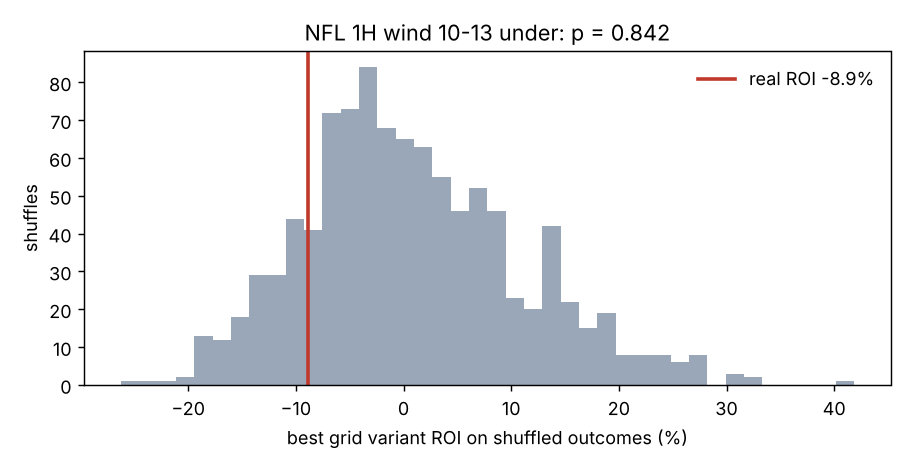

# NFL 1H wind 10-13 under (wind1014_1h)

Verdict: **PAPER ONLY** (grid p 0.842; walk-forward +8.4% on 25 (p 0.180); holdout +8.4% on 25; no plateau)

Live definition: lo 10, hi 13. Price: 1H line 10 min before kickoff: Pinnacle, else US-book median. Seasons: 2023, 2024, 2025; holdout 2025. Base pool: 484 bets of this market.

## Gate 1: in-sample (all seasons before the holdout)

N 82, record 37-42, units -7.29, ROI -8.9%. Flags: N < 100 (thin). Leakage review: none.

| Season | N | ROI |
|---|---|---|
| 2023 | 44 | -11.5% |
| 2024 | 38 | -5.9% |
| 2025 | 22 | +49.0% |

## Gate 2: permutation (1,000 shuffles within season x price decile)

Best of 29 grid variants per shuffle (N >= 30): p = 0.842. Plain single-filter permutation (weaker): p = 0.381.

## Gate 3: walk-forward (fit on earlier seasons, bet the next blind)

| Season | Variant fitted | N | ROI |
|---|---|---|---|
| 2025 (holdout) | lo 12, hi 99 | 25 | +8.4% |

Out-of-sample before the holdout: n/a on 0. Holdout: +8.4% on 25. All walk-forward seasons: +8.4% on 25.

## Gate 4: walk-forward permutation (200 shuffles of the walk-forward seasons)

p = 0.180 (bar 0.05 with 1 walk-forward season(s)).

## Plateau (grid neighbours of the live definition, in-sample)

| Variant | N | ROI |
|---|---|---|
| lo 9, hi 13 | 104 | -11.9% |
| lo 11, hi 13 | 42 | -18.1% |
| lo 10, hi 12 | 74 | -9.4% |
| lo 10, hi 14 | 88 | -4.1% |

Plateau: no.

## Whole grid (in-sample)

| Variant | N | ROI |
|---|---|---|
| lo 12, hi 99 | 56 | +1.5% |
| lo 10, hi 99 | 112 | -1.2% |
| lo 11, hi 99 | 72 | -2.3% |
| lo 12, hi 16 | 47 | -2.4% |
| lo 10, hi 16 | 103 | -3.2% |
| lo 10, hi 14 | 88 | -4.1% |
| lo 12, hi 14 | 32 | -4.5% |
| lo 9, hi 99 | 134 | -4.8% |
| lo 10, hi 15 | 95 | -5.1% |
| lo 11, hi 16 | 63 | -5.7% |
| lo 9, hi 16 | 125 | -6.7% |
| lo 12, hi 15 | 39 | -6.8% |
| lo 9, hi 14 | 110 | -7.9% |
| lo 11, hi 14 | 48 | -8.2% |
| lo 9, hi 15 | 117 | -8.5% |
| lo 8, hi 99 | 163 | -8.8% |
| lo 10, hi 13 | 82 | -8.9% |
| lo 11, hi 15 | 55 | -9.3% |
| lo 10, hi 12 | 74 | -9.4% |
| lo 8, hi 16 | 154 | -10.6% |
| lo 9, hi 13 | 104 | -11.9% |
| lo 8, hi 14 | 139 | -11.9% |
| lo 8, hi 15 | 146 | -12.2% |
| lo 9, hi 12 | 96 | -12.5% |
| lo 8, hi 13 | 133 | -15.2% |
| lo 8, hi 12 | 125 | -15.9% |
| lo 11, hi 13 | 42 | -18.1% |
| lo 12, hi 13 | 26 | -19.7% |
| lo 11, hi 12 | 34 | -21.4% |
